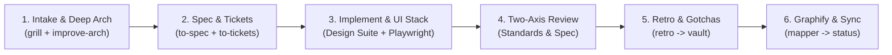

# Agent Instructions & Memory Bank Protocol

This workspace uses a persistent **Agent Memory Vault** located in `vault/`, inspired by Obsidian vaults and Supermemory.
All AI agents working in this repository MUST follow the strict protocols below to ensure zero context loss and protect source requirements.

---

## 🔒 Golden Rule: PRD Immutability

1. **`vault/PRD.md` is STRICTLY READ-ONLY (IMMUTABLE)**:
   - The primary `vault/PRD.md` contains the foundational product requirements.
   - **NEVER edit, modify, truncate, or overwrite `vault/PRD.md` directly under any circumstances.**
2. **Modification / Iteration Workflow**:
   - If the user asks to modify, update, or experiment with the PRD, **ALWAYS duplicate `vault/PRD.md` first**.
   - Save the copy as `vault/PRD_edit.md` (or `vault/PRD_edit_<topic>.md` according to the user's prompt).
   - Apply all modifications to the `vault/PRD_edit*.md` copy, leaving the original `vault/PRD.md` completely intact.

---

## 🔄 Mandatory Development Pipeline: `astraonyx-dev`

All development tasks in this repository MUST follow the unified 6-stage **`astraonyx-dev`** pipeline:

1. **Stage 1: Intake & Deep Architecture**:
   - Read `vault/PRD.md` (Immutable) & `vault/DESIGN.md`.
   - Walk the decision tree via `grill-me` (ask one question at a time using `ask_question`).
   - Deepen modules using `improve-codebase-architecture` & `codebase-design`.
   - Update `vault/glossary.md` and `vault/decisions.md` (ADRs).
2. **Stage 2: Formal Spec & Ticket Slicing**:
   - Synthesize requirements via `to-spec` (Problem, Solution, User Stories, Seams).
   - Slice into tracer-bullet vertical tickets via `to-tickets` (with blocking edges).
3. **Stage 3: Implementation & Elite UI/UX Design Stack**:
   - Zero-Placeholder Mandate: No partial code or `// TODO`. 100% complete production implementations.
   - For UI/UX: Activate the Elite Design Suite (`frontend-design`, `design-taste-frontend`, `high-end-visual-design`, `emil-design-eng`, `design-motion-principles`, `impeccable-design-polish`, `figma-*`).
   - Run `python .agents/skills/astraonyx-dev/scripts/audit_ui_slop.py` and auto-fix findings.
   - Run live interactive click testing via `playwright-cli`.
4. **Stage 4: Two-Axis Code Review**:
   - Run `code-review` across Standards Axis (Fowler smells) and Spec Axis (requirements match).
5. **Stage 5: Retrospective & Gotcha Logging**:
   - Run `retro` and record any newly discovered gotchas/errors in `vault/modules/<module>.md` and `vault/error.md`.
6. **Stage 6: Graphify & Vault Synchronization**:
   - Run `python .agents/skills/codebase-relation-mapper/scripts/map_relationships.py` to update the Graphify map.
   - Update `vault/status.md` and log milestones in `vault/sessions/`.

---

## 🧠 Memory Vault Structure (`vault/`)

The `vault/` folder is the persistent memory bank:
- **`vault/index.md`**: Map of Content (MOC), central hub connecting all notes with Obsidian-style links.
- **`vault/PRD.md`**: Product Requirements Document (strictly read-only).
- **`vault/DESIGN.md`**: Visual & architectural design guide.
- **`vault/status.md`**: Active context, current goals, active task checklist, blockers, and immediate next steps.
- **`vault/error.md`**: Knowledge base of past bugs/errors, root causes, quick fixes, and prevention rules.
- **`vault/relationships.md`**: Codebase relationship & dependency graph (which file relates to which).
- **`vault/context.md`**: Tech stack details, environment specs, user preferences, and architecture overview.
- **`vault/decisions.md`**: Architectural Decision Records (ADRs) documenting technical decisions.
- **`vault/sessions/`**: Chronological session logs and archives of past project conversations.

---

## 🛠️ Error Handling & Session Updates

1. **Error Logging**:
   - When encountering an error, check `vault/error.md` first.
   - After resolving any non-trivial error, append an entry to `vault/error.md` with: ID, Title, Symptom, Root Cause, Solution, and Prevention Rule.
2. **Session Updates**:
   - Keep `vault/status.md` updated as tasks progress.
   - Log project milestones in `vault/sessions/` when concluding work on a task.
