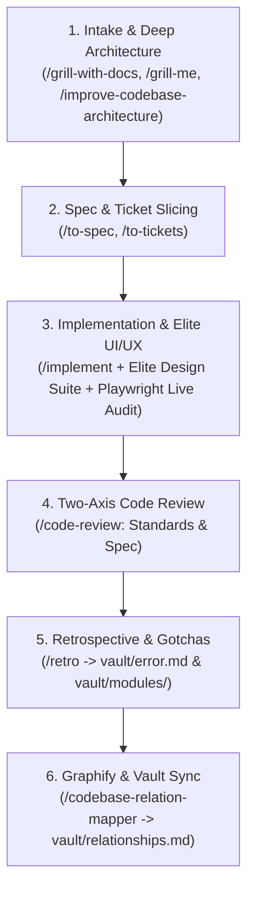

# ⚡ astraonyx-dev: Master Autonomous Development Pipeline

The **`astraonyx-dev`** skill is the unified master engineering engine for the Astraonyx-Ataraxia ecosystem. It automates and chains together the entire software lifecycle from initial interview to production-grade deployment and permanent memory synchronization:



---

## 🧭 The 6-Stage Master Execution Workflow

---

### STAGE 1: Intake, Grilling & Architecture Deepening
*Skills: `grill-with-docs`, `grill-me`, `improve-codebase-architecture`, `codebase-design`*

1. **Relentless Interview & Decision Tree (`grill-me`)**:
   - Never assume requirements. Walk the decision tree in rounds using `ask_question`.
   - Ask questions one at a time, providing the recommended answer for each.
2. **Deepening Opportunities & Seam Design (`improve-codebase-architecture`)**:
   - Use the `/codebase-design` vocabulary: **module**, **interface**, **depth**, **seam**, **adapter**, **locality**.
   - Prefer deep modules (simple interface hiding complex behavior) over shallow ones.
   - Run the **deletion test**: deleting a good module should concentrate complexity, not scatter it.
3. **Crystallize into Vault**:
   - Update terms in **`vault/glossary.md`** (*Ubiquitous Language*).
   - Record non-trivial, hard-to-reverse decisions in **`vault/decisions.md`** (*ADRs*).

---

### STAGE 2: Formal Spec & Ticket Slicing
*Skills: `to-spec`, `to-tickets`*

1. **Synthesize the Spec (`to-spec`)**:
   - Synthesize the agreed architecture into: Problem Statement, Solution, numbered User Stories, Implementation Decisions, Testing Seams, and Out-of-Scope boundaries.
2. **Slice Tracer-Bullet Tickets (`to-tickets`)**:
   - Break the work into **tracer-bullet vertical slices**: each slice cuts through all layers (UI, API, Data, Tests) and is demoable on its own.
   - Declare explicit **blocking edges** (`Blocked by: Ticket NN`).
   - Slices must fit into clean execution contexts.

---

### STAGE 3: Implementation & Elite UI/UX Design Stack
*Skills: `implement`, `frontend-design`, `design-taste-frontend`, `high-end-visual-design`, `emil-design-eng`, `design-motion-principles`, `impeccable-design-polish`, `generative_ui`, `figma-*`*

1. **Pre-Code Thinking & Zero-Placeholder Mandate**:
   - Algorithmic complexity analysis ($O(1)$ or $O(n)$).
   - Dilarang keras menulis placeholder (`// TODO`, `// rest of code`, skeleton drafts). Kode wajib **100% tuntas dan siap produksi**.
2. **IF Frontend / UI/UX — Activate Elite Design Suite**:
   - **Vanguard & High-End Aesthetic (`high-end-visual-design`)**:
     - No generic fonts (prefer `Geist`, `Plus Jakarta Sans`, `PP Editorial New`).
     - Subtle multi-layered depth (`box-shadow: 0 1px 2px rgba(0,0,0,0.04), 0 8px 16px rgba(0,0,0,0.03)`).
     - Generous whitespace, asymmetric layouts, bold mathematical typography hierarchy.
   - **Emil Kowalski Motion Craft (`emil-design-eng`, `design-motion-principles`)**:
     - Spring physics curves, interpolated gestures, hardware-accelerated transforms (`transform`, `opacity`), zero linear/instant state jumps.
   - **Figma Design Rules (`figma-create-design-system-rules`, `figma-use`)**:
     - Extract tokens and maintain 1:1 fidelity with component libraries.
3. **Playwright Visual & Anti-Slop Audit**:
   - Run the automated auditor:
     ```powershell
     python .agents/skills/astraonyx-dev/scripts/audit_ui_slop.py [target]
     ```
   - Auto-fix any generic AI gradients, glassmorphism slop, or contrast issues immediately.
4. **Live Interactive Testing (Mencoba Langsung)**:
   - Jalankan web dan lakukan pengujian klik/interaksi nyata menggunakan `playwright-cli`:
     ```powershell
     playwright-cli open http://localhost:<port>
     playwright-cli click <selector>
     playwright-cli screenshot
     ```

---

### STAGE 4: Two-Axis Code Review & Red-Team Pentest
*Skills: `code-review`, `astraonyx-redhat`*

Before committing changes, review the code across three verification gates:
1. **Standards Axis**:
   - Does the diff violate repo standards or Fowler code smells (*Mysterious Name, Duplicated Code, Feature Envy, Primitive Obsession, Speculative Generality*)?
2. **Spec Axis**:
   - Does the diff faithfully fulfill the user stories without scope creep or missed edge cases?
3. **Red-Team Penetration Test (`astraonyx-redhat`)**:
   - Run the autonomous hacker auditor:
     ```powershell
     python .agents/skills/astraonyx-redhat/scripts/redhat_pentest.py --report --fuzz --safe-restore
     ```
   - If any CRITICAL or HIGH vulnerabilities are detected (SQLi, Secret Leaks, Auth Bypass, IDOR), the build is blocked until patched!
4. Fix any reported violations before proceeding.

---

### STAGE 5: Retrospective & Gotcha Logging
*Skills: `retro`*

1. **Conduct Session Retrospective (`retro`)**:
   - Identify what caused friction: Navigation, missing automated checks, or tool efficiency.
2. **Log Gotchas to Vault**:
   - If a new bug, race condition, or technical pitfall was resolved, append it immediately to:
     - `vault/modules/<target-module>.md`
     - `vault/error.md` (Global Error Hub)

---

### STAGE 6: Graphify & Vault Synchronization
*Skills: `codebase-relation-mapper`*

1. **Re-run the Graphify Scanner**:
   ```powershell
   python .agents/skills/codebase-relation-mapper/scripts/map_relationships.py
   ```
   - Synchronizes `vault/relationships.md` (clustered Mermaid graph & dependency matrix) and `vault/symbols.md` (global API registry).
2. **Update Status**:
   - Mark completed tickets in `vault/status.md`.
3. **Archive Session**:
   - Record milestone summary in `vault/sessions/` using `vault/sessions/template.md`.

---

## ⚡ CLI Utilities Bundled in `astraonyx-dev`

| Perintah | Deskripsi |
| :--- | :--- |
| `python .agents/skills/astraonyx-dev/scripts/audit_ui_slop.py <path>` | Audit otomatis Anti-AI-Slop & standar visual UI |
| `python .agents/skills/astraonyx-dev/scripts/vault_query.py "<query>"` | Mesin pencari memori instan (semantic search) ke seluruh vault |
| `python .agents/skills/codebase-relation-mapper/scripts/map_relationships.py` | Scanner keterhubungan file, klaster Graphify & registri simbol |
| `python .agents/skills/codebase-relation-mapper/scripts/map_relationships.py --impact <file>` | Analisis dampak perubahan file langsung & transitif |
| `python .agents/skills/codebase-relation-mapper/scripts/map_relationships.py --find <symbol>` | Pencarian deklarasi kelas/fungsi secara instan |
