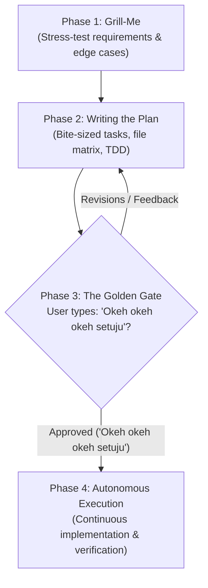

# Plan Superpowers

An end-to-end engineering discipline engine for turning raw ideas into battle-tested, executed features with zero unapproved surprises.

## The 4-Phase Operating Protocol

---

## Phase 1: The Grill-Me Interview
*Reference: [Grill-Me Protocol](references/grill-interview.md)*

Before drafting any plan or touching code, probe deep into user assumptions:
1. **Unpack Requirements**: Never accept ambiguous goals. Ask clarifying questions using `ask_question` or structured inquiry.
2. **Stress-Test Failure Modes**:
   - What happens on network disconnect or server timeout?
   - How are race conditions, duplicate submissions, and data consistency handled?
   - What are the performance limits (scale, payload size, latency)?
3. **Lock Decisions**: Formulate explicit scope inclusions, exclusions, and technical invariants.

---

## Phase 2: Writing the Implementation Plan
*Reference: [Plan Template Specification](references/plan-template.md)*

Synthesize the requirements into a modular, actionable plan document:
1. **Header**: State the Goal, Architectural Approach, and Tech Stack in 1-3 sentences each.
2. **Global Constraints**: Strict invariants (zero truncation, zero regressions on existing IDs/APIs, syntax validation).
3. **File Matrix**: Explicit list of files to Create, Modify, and Test with exact paths.
4. **Task Decomposition**: Break the work into sequential phases. Every task must have:
   - Specific target files.
   - Bite-sized step instructions.
   - Independent verification check (test command or syntax check).
5. **Artifact Output**: Render the plan as an Antigravity Plan Artifact with `RequestFeedback=true`.

---

## Phase 3: The Golden Gate (Confirmation Rule)
*Reference: [Execution Engine](references/execution-engine.md)*

> [!CAUTION]
> **STRICT EXECUTION LOCK**: The agent **MUST NOT** edit codebase files, create feature files, or execute implementation commands until explicit approval is given.

Present the plan clearly to the user, concluding with the exact prompt:
> **"Ketik 'Okeh okeh okeh setuju' untuk menyetujui rencana ini dan memulai eksekusi otomatis."**

- If the user asks questions or requests adjustments, update the plan and re-prompt.
- If and only if the user submits the exact phrase **`"Okeh okeh okeh setuju"`** (or unambiguous explicit approval), proceed immediately to Phase 4.

---

## Phase 4: Autonomous Disciplined Execution
*Reference: [Execution Engine](references/execution-engine.md)*

Once approved:
1. **Continuous Execution**: Run through all tasks in sequence without stopping to ask "Should I continue?" after each task.
2. **TDD / Verification Gate**: Run the verification step for each task before marking it complete.
3. **Check-off Progress**: Update the plan document checkboxes (`- [x]`) as tasks are completed.
4. **Ledger Rulings**: Document any necessary non-breaking adjustments as `Ruling: <decision> — <reason>`.
5. **Zero Truncation**: Deliver 100% complete, runnable code files.
6. **Final Smoke Test**: Execute build and test suites to verify 100% green status.
